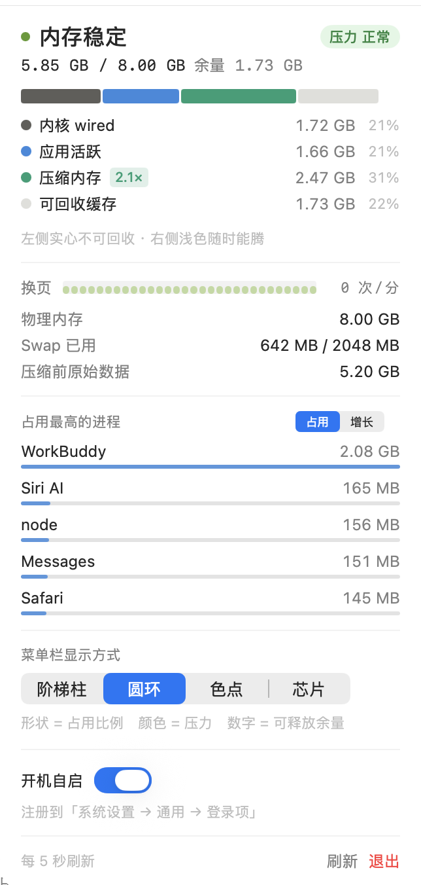

# MemBar

macOS 菜单栏内存监控 · 原生 Swift 手写 · 零第三方依赖 · 常驻内存约 30 MB

[](#)
[](#)
[](#)

为 8GB 内存的 Mac mini M2 写的：不是又一个「显示个百分比」的工具，而是回答一个问题——**现在到底有没有事**。

菜单栏不给百分比，给**可释放余量**（`1.7G`）和**一句结论**（`内存稳定`）；圆环颜色只在内核报警或开始换页时才变。点开面板，再把 Apple Silicon 上内存的真实构成拆开：**内核 wired、应用活跃、压缩内存、可回收缓存**。

## 预览

| 菜单栏（4 种样式） | 弹出面板 |
|---|---|
|     |  |

## 下载安装

**不想编译的，直接下成品** → [**Releases 页面**](https://github.com/kaiying1994/MemBar/releases/latest)

| 文件 | 说明 |
|---|---|
| `MemBar-1.0.0.dmg` | 推荐。打开后把 MemBar.app 拖进「应用程序」 |
| `MemBar-1.0.0-macOS-universal.zip` | 解压得到 MemBar.app，拖进「应用程序」 |

Universal 二进制，**Apple Silicon 与 Intel 通吃**；要求 **macOS 13.0+**。

### 首次打开被 macOS 拦下？

App 未做 Apple 公证（需付费开发者账号），系统会提示「无法验证开发者」或「已损坏」。这是**签名状态**问题，不是文件坏了。二选一：

**方法一（图形界面）**：在「应用程序」里 **右键点 MemBar.app → 打开 → 再点「打开」**。只需一次。

**方法二（终端，一条命令）**：
```bash
xattr -dr com.apple.quarantine /Applications/MemBar.app
```

打开后菜单栏右上角出现图标即成功。**没有 Dock 图标是正常的**——菜单栏 App 的设计如此。

## 特性

- **菜单栏回答「还够不够用」**：数字是**可释放余量**（`1.7G`），不是占用百分比；圆环/柱子仍表示占用比例，颜色则只跟随内核压力与换页速率——Mac 的 70~85% 常年健康，按占用上色只会一直黄灯
- **一句话结论**：压力 / 换页速率合成「内存稳定 · 轻微换页 · 换页频繁 · 内存紧张」，比数字更快读出状态
- **换页心跳条**：`vm_stat` 的 `swapouts` 是单调计数器，工具做差分后给「每分钟换页次数」+ 最近 30 次采样的心跳格——这才是切窗口卡半秒的真实来源
- **拆解式面板**：分段堆叠条按「能不能腾出来」排序（wired → active → 压缩 → 可回收），附压缩倍数、压缩前原始数据、Swap
- **进程榜双排序**：`按占用` 看谁最大，`按增长` 看谁在涨（60 秒滑动窗口差分）。拖垮 8G 机器的从来不是占用最高的那个，而是持续上涨的那个
- **4 种菜单栏样式**：圆环 / 阶梯柱 / 色点 / 芯片，面板里点击即时切换并记忆
- **面板内开关的开机自启**：走苹果官方 `SMAppService`，注册到「系统设置 → 通用 → 登录项」，不碰 `launchctl`
- **单实例保护**：直接跑 binary 双开时自动退出后启动的那个

## 为什么不用现成工具

| 方案 | 问题 |
|---|---|
| 活动监控器 | 没有常驻菜单栏视图，且不拆 wired/压缩 |
| iStat Menus 等 | 收费、全家桶、常驻开销大 |
| xbar / rumps 插件 | 需要额外运行时，8GB 机器上不划算 |

MemBar 用 `swiftc` 直接编译成单个二进制，无 Homebrew 依赖、无运行时。

## 从源码构建

```bash
git clone https://github.com/kaiying1994/MemBar.git
cd MemBar
bash build.sh          # 编译 → ad-hoc 签名 → 组装 ~/Applications/MemBar.app
```

要求：macOS 13.0+（Apple Silicon 或 Intel）、Xcode Command Line Tools（`xcode-select --install`）。

打包可分发产物（universal zip + dmg，输出到 `dist/`）：

```bash
bash package-release.sh
```

重新生成图标（可选）：

```bash
swiftc -O -o /tmp/makeicon make-icon.swift && /tmp/makeicon
iconutil -c icns MemBar.iconset -o MemBar.icns
```

## 使用

菜单栏点击图标弹出面板：

- **一句话结论 + 段条**：顶部不是大号百分比，而是「内存稳定 / 轻微换页 / 内存紧张」和彩点；下面按可释放顺序排的四段条
- **换页行**：`0 次/分` + 30 格心跳，看得见「刚才有没有换过页」
- **进程榜**：右上角切「占用 / 增长」，增长模式显示 `+120 MB/分`
- **样式切换**：阶梯柱 / 圆环 / 色点 / 芯片，点击即时生效
- **开机自启**：开关拨一下即可，注册到系统登录项
- 面板每 5 秒刷新；「刷新」按钮强制做一次全量采样（含进程榜与增速基准）

### 命令行参数

```bash
.../MemBar.app/Contents/MacOS/MemBar --show                    # 启动即弹出面板
.../MemBar.app/Contents/MacOS/MemBar --style=bars|ring|text|chip  # 指定样式
.../MemBar.app/Contents/MacOS/MemBar --panel-window            # 面板放进独立窗口（便于截图）
.../MemBar.app/Contents/MacOS/MemBar --proc=growth             # 进程榜默认按增长排序
.../MemBar.app/Contents/MacOS/MemBar --enable-autostart        # 注册登录项
.../MemBar.app/Contents/MacOS/MemBar --disable-autostart       # 注销登录项
.../MemBar.app/Contents/MacOS/MemBar --autostart-status        # 查询登录项状态
```

## 数据来源

全部走内核原始接口，不依赖 `ps` / `powermetrics`：

| 数据 | 接口 |
|---|---|
| 内存分类计数 | `host_statistics64` + `vm_statistics64_data_t` |
| 页大小 | `host_page_size()`（Apple Silicon 实际是 16KB，不要写死 4096） |
| Swap | `sysctlbyname("vm.swapusage")` |
| 内核内存压力 | `sysctlbyname("kern.memorystatus_vm_pressure_level")` |
| 进程占用 | `proc_listpids()` + `proc_pid_rusage(pid, RUSAGE_INFO_V2)` |
| 进程名 | `proc_pidpath()` 反推 `.app` 名 |

## 实测开销

| 指标 | 数值 |
|---|---|
| 物理内存（phys_footprint） | ≈ 21–34 MB |
| CPU（面板关闭，5 秒刷新） | ≈ 0.07%（单核百分比，8 核折算约 0.01%） |

优化前后的实测对比（M2 8GB，`top` 连续采样）：

| 版本 | 刷新间隔 | 平均 CPU |
|---|---|---|
| 早期 | 2 秒 | 1.46% |
| 现在 | 5 秒 | **0.07%** |

把「数字」从位图里挪到 `attributedTitle`、采样值改走非 `@Published` 通道，都是必要的清理；但真正把 CPU 打下来的是刷新间隔——2 秒改 5 秒，因为内存百分比本身以十秒为单位变化。面板打开时才读进程榜，关掉即停。

## 踩坑记录

写这个组件时真实踩过、并在代码里规避掉的坑：

1. **页大小写死 4096**：Apple Silicon 的 Mach 页是 **16KB**，按 4096 换算所有内存数字都会**少算 4 倍**。必须用 `host_page_size()` 读。
2. **菜单栏文字颜色**：`NSApp.effectiveAppearance` 反映的是 App 的深浅色；菜单栏颜色由系统按**壁纸亮度**决定（浅色模式 + 深色壁纸 = 白字）。自绘菜单栏 UI 一律用 `NSStatusItem.button?.effectiveAppearance`。
3. **用占用率上色是错的**：macOS 的「已用」常年 70~85% 却完全健康（内存被缓存占满才是设计目标），按 75%/88% 分档上色等于永久黄灯，用户很快就学会无视它。颜色应当只跟随 `kern.memorystatus_vm_pressure_level` 与换页速率；同时把数字换成「可释放余量」，因为余量本身就是答案，占用率还要用户自己判断多少算多。
4. **`launchctl bootstrap` 报 `Input/output error`**：本机上下文（沙箱/受限环境）无法注册 LaunchAgent，连 `/bin/echo` 的合法 plist 也不行。改用 `SMAppService.mainApp` 一次成功。
5. **Swift 6 编译器下的 `@MainActor`**：`@MainActor` 类里写 `nonisolated init()` 再去改 `@Published` 属性会报错；改用属性默认值 + `@MainActor` 的 `loadXxx()` 方法在启动时调用。
6. **`NSHostingController` 高度**：SwiftUI 内容高度不等于 popover 高度，写死会裁切。用 `sizingOptions = [.preferredContentSize]` + `view.fittingSize` 动态设定。
7. **命令行 `swiftc` 下 `@State` 宏不可用**：`swiftc main.swift` 直接编译时，`@State` 会报 `external macro implementation type 'SwiftUIMacros.StateMacro' could not be found ... malformed response`，连 `$binding` 一起崩。视图内部状态应挂到 `ObservableObject` 上（`@Published` + `Binding(get:set:)`），本项目的「进程榜排序切换」就是这么做的。
8. **`NSPopover` 是 transient 的，截不到图**：它一失去焦点就自动关闭，`screencapture` 永远拍到空白。调试时用 `--panel-window` 把同一个 SwiftUI 视图塞进 `NSWindow(.floating)`；另外 `open -a App --args xx` 传参不可靠（可能复用已注册实例），要直接执行 `App.app/Contents/MacOS/App`。
9. **增速不能跟上一次采样比**：5 秒窗口下，进程启动/退出造成的差值能把结果放大到几百 MB/分，全是假警报。用 60 秒滑动窗口、以窗内最早一次采样为基准才稳。

## License

MIT
