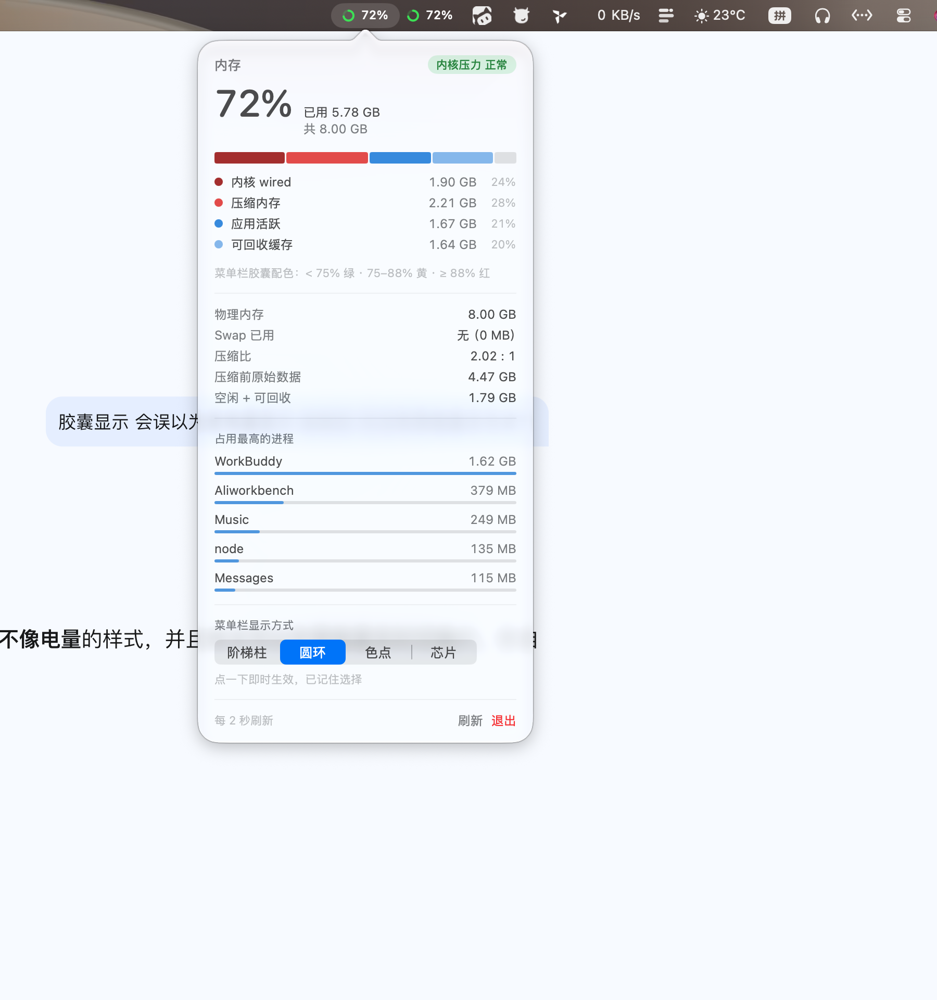

# MemBar

macOS 菜单栏内存监控 · 原生 Swift 手写 · 零第三方依赖 · 常驻内存约 30 MB

[](#)
[](#)
[](#)

为 8GB 内存的 Mac mini M2 写的：不是又一个「显示个百分比」的工具，而是把 Apple Silicon 上内存的真实构成拆开给你看——**内核 wired、压缩内存、应用活跃、可回收缓存**各占多少。

## 预览

| 菜单栏（4 种样式） | 弹出面板 |
|---|---|
|     |  |

## 特性

- **拆解式面板**：分段堆叠条 + 图例，直接看到 8GB 被谁吃了，附 Swap、压缩比、压缩前原始数据、空闲+可回收
- **进程榜 Top 5**：按 Activity Monitor 同口径（`phys_footprint`）排序；Electron 类进程自动从可执行路径反推真实应用名并合并同名子进程
- **颜色与数字同源**：菜单栏颜色严格跟随百分比（`<75%` 绿 · `75–88%` 黄 · `≥88%` 红），不会出现「数字降了颜色还黄着」的矛盾；内核判定 CRITICAL 时强制红
- **4 种菜单栏样式**：圆环 / 阶梯柱 / 色点 / 芯片，面板里点击即时切换并记忆
- **面板内开关的开机自启**：走苹果官方 `SMAppService`，注册到「系统设置 → 通用 → 登录项」，不碰 `launchctl`
- **单实例保护**：直接跑 binary 双开时自动退出后启动的那个

## 为什么不用现成工具

| 方案 | 问题 |
|---|---|
| 活动监控器 | 没有常驻菜单栏视图，且不拆 wired/压缩 |
| iStat Menus 等 | 收费、全家桶、常驻开销大 |
| xbar / rumps 插件 | 需要额外运行时，8GB 机器上不划算 |

MemBar 用 `swiftc` 直接编译成单个二进制，无 Homebrew 依赖、无运行时。

## 构建

```bash
git clone https://github.com/<你的用户名>/MemBar.git
cd MemBar
bash build.sh          # 编译 → ad-hoc 签名 → 组装 ~/Applications/MemBar.app
```

要求：macOS 13.0+（Apple Silicon 或 Intel）、Xcode Command Line Tools（`xcode-select --install`）。

重新生成图标（可选）：

```bash
swiftc -O -o /tmp/makeicon make-icon.swift && /tmp/makeicon
iconutil -c icns MemBar.iconset -o MemBar.icns
```

## 使用

菜单栏点击图标弹出面板：

- **样式切换**：阶梯柱 / 圆环 / 色点 / 芯片，点击即时生效
- **开机自启**：开关拨一下即可，注册到系统登录项
- 面板每 2 秒刷新；「刷新」按钮强制做一次全量采样（含进程榜）

### 命令行参数

```bash
.../MemBar.app/Contents/MacOS/MemBar --show                    # 启动即弹出面板
.../MemBar.app/Contents/MacOS/MemBar --style=bars|ring|text|chip  # 指定样式
.../MemBar.app/Contents/MacOS/MemBar --enable-autostart        # 注册登录项
.../MemBar.app/Contents/MacOS/MemBar --disable-autostart       # 注销登录项
.../MemBar.app/Contents/MacOS/MemBar --autostart-status        # 查询登录项状态
```

## 数据来源

全部走内核原始接口，不依赖 `ps` / `powermetrics`：

| 数据 | 接口 |
|---|---|
| 内存分类计数 | `host_statistics64` + `vm_statistics64_data_t` |
| 页大小 | `host_page_size()`（Apple Silicon 实际是 16KB，不要写死 4096） |
| Swap | `sysctlbyname("vm.swapusage")` |
| 内核内存压力 | `sysctlbyname("kern.memorystatus_vm_pressure_level")` |
| 进程占用 | `proc_listpids()` + `proc_pid_rusage(pid, RUSAGE_INFO_V2)` |
| 进程名 | `proc_pidpath()` 反推 `.app` 名 |

## 实测开销

| 指标 | 数值 |
|---|---|
| 物理内存（phys_footprint） | ≈ 28–32 MB |
| CPU | ≈ 0.8%（单核百分比，8 核折算约 0.1%） |

## 踩坑记录

写这个组件时真实踩过、并在代码里规避掉的坑：

1. **页大小写死 4096**：Apple Silicon 的 Mach 页是 **16KB**，按 4096 换算所有内存数字都会**少算 4 倍**。必须用 `host_page_size()` 读。
2. **菜单栏文字颜色**：`NSApp.effectiveAppearance` 反映的是 App 的深浅色；菜单栏颜色由系统按**壁纸亮度**决定（浅色模式 + 深色壁纸 = 白字）。自绘菜单栏 UI 一律用 `NSStatusItem.button?.effectiveAppearance`。
3. **数字与颜色不同源**：`kern.memorystatus_vm_pressure_level` 反映压缩/换页吞吐活跃度，与占用率天然不同步且带滞后。给用户看的指示器，数字和颜色必须同一量纲。
4. **`launchctl bootstrap` 报 `Input/output error`**：本机上下文（沙箱/受限环境）无法注册 LaunchAgent，连 `/bin/echo` 的合法 plist 也不行。改用 `SMAppService.mainApp` 一次成功。
5. **Swift 6 编译器下的 `@MainActor`**：`@MainActor` 类里写 `nonisolated init()` 再去改 `@Published` 属性会报错；改用属性默认值 + `@MainActor` 的 `loadXxx()` 方法在启动时调用。
6. **`NSHostingController` 高度**：SwiftUI 内容高度不等于 popover 高度，写死会裁切。用 `sizingOptions = [.preferredContentSize]` + `view.fittingSize` 动态设定。

## License

MIT
